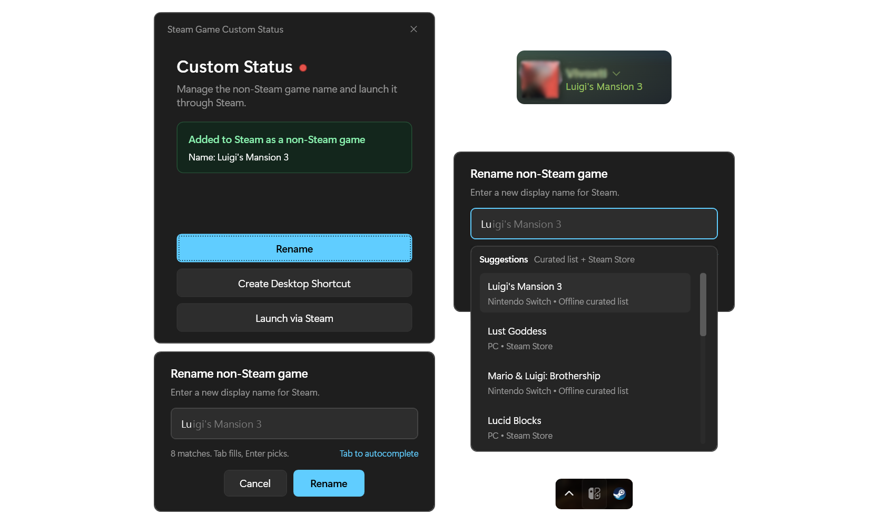

# Steam Game Custom Status

Minimal tray-first Windows app for people who run it through Steam as a `non-Steam game` and want quick control over the title Steam shows for the **current executable path**.

It stays out of the way, lives in the system tray, shows whether the current build is registered in Steam, and lets you rename the matching shortcut without digging through `shortcuts.vdf` manually.



_Compact main window for Steam status, rename, and quick actions._

## Highlights

- **Tray-first by design** — starts in the tray and closing the window hides it back there
- **Path-based matching** — only touches the Steam shortcut whose `Exe` matches the current running `.exe`
- **Steam-aware status** — shows the current Steam name plus Active / Inactive state
- **Safe rename flow** — creates `shortcuts.vdf.bak` before saving changes
- **Useful launch actions** — supports `Launch via Steam` and desktop shortcuts via `steam://rungameid/...`
- **Compact rename UX** — manual naming stays primary, with offline + online suggestions when available
- **Nintendo Switch → Steam** — optionally shows the game you are playing on Switch / Switch 2 as your Steam status

## Nintendo Switch status (optional)

Nintendo's app API only reports presence for *friends*, so the app reads your status through a separate **bot Nintendo Account** that is friends with your main one. Setup lives in the tray menu under **Nintendo Switch…**:

1. Create a throwaway Nintendo Account and add it as a friend of your main account (your online status must be visible to friends).
2. **Sign in…** with the bot account (never your main one).
3. Pick your main account from the bot's friend list and turn on **Show my Switch game in Steam**.

While you play, Steam shows the Switch title as a non-Steam game and the tray icon turns **red**. Each title gets its own non-Steam shortcut (tagged *Nintendo Switch*); the first time a title is seen Steam restarts once to load it, and it is skipped while another Steam game is running. Status updates every 1–5 minutes.

Settings, the bot session, and downloaded game icons are kept in a `SteamGameCustomStatus.data` folder next to the exe (or in `%LOCALAPPDATA%\SteamGameCustomStatus` if that folder is not writable). The feature is unofficial (it uses [nxapi](https://github.com/samuelthomas2774/nxapi) and its third-party token service) and can break when Nintendo changes its app. Nintendo allows only a few sign-ins per hour.

## Typical flow

1. Download `SteamGameCustomStatus.exe` from [Releases](https://github.com/Vivoxti/Steam-game-custom-status/releases) (or publish it yourself) and put it in a permanent folder.
2. Add that executable to Steam as a **non-Steam game**.
3. Launch it from Steam when you want Steam presence integration.
4. Use the tray menu or compact window to rename the entry, create a desktop shortcut, or relaunch through Steam.

If the app is not registered yet, it can open Steam to the add-game flow and also shows the current executable path for manual selection.

## What to expect

- The tray icon mirrors Steam activity: **white** while active, **gray** while inactive, **red** while Steam shows your Switch game.
- If the shortcut exists but the app was started outside Steam, `Launch via Steam` becomes available.
- After rename, the app can restart Steam safely when immediate apply is possible.
- Only the published executable path should be added to Steam; debug builds or copies from other folders will not match. When updating, replace the exe in the same folder so the Steam shortcut keeps working.
- Single-instance behavior prefers the Steam-launched instance when needed.

## Build and publish

Canonical executable build:

```powershell
dotnet publish -c Release
```

The first build also builds the embedded Nintendo bridge (`tools/nxapi-bridge`, needs Node.js 24); pass `-p:SkipNxapiBridgeBuild=true` to build without it.

Published executable:

```text
bin\Release\net10.0-windows\win-x64\publish\SteamGameCustomStatus.exe
```

## Stack

- `.NET 10`
- `WPF`
- `Windows Forms NotifyIcon`
- `WebView2` (Nintendo sign-in)
- `nxapi` packaged as a Node single-executable app (`tools/nxapi-bridge`, AGPL-3.0)

## License

GPL-3.0. The embedded Nintendo bridge in `tools/nxapi-bridge` is AGPL-3.0-or-later (it bundles nxapi); see its `NOTICE`.

## More context

Detailed runtime behavior, safety boundaries, and release verification notes live in [`docs/project-context.md`](./docs/project-context.md).

